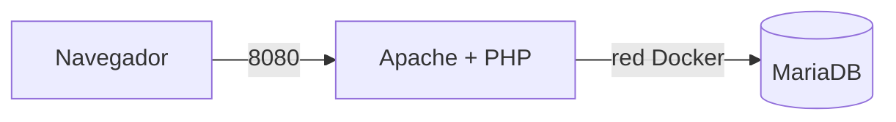

**PRACTICA FINAL RA1 - salón recreativo 
ROCIO ALBELDA
IMPLANTACION DE APLICACIONES WEB**

**Descripción del Stack y Tecnologías**

Servidor Web: Apache 2.4 (Ejecutado en el contenedor `web`).
Intérprete Backend:PHP 8.2 (Ejecutado en el servidor para lógica de negocio, horas UTC y conexión a BD).
SGBD:MariaDB 10.11 (Ejecutado en el contenedor `db`).
Cliente:Navegador Web (Ejecuta HTML/CSS y JavaScript para la hora local).

**Diagrama de arquitectura en Mermaid**

**Comandos de despliegue:**
**EN LOCAL USAMOS LOS SIGUIENTES:**
git clone <URL_DE_TU_REPOSITORIO>
cd salon-recreativo
cp .env.example .env
docker compose up -d

**Y PARA Play with Docker USAREMOS:**
git clone <URL_DE_TU_REPOSITORIO>
cd salon-recreativo
cp .env.example .env
docker compose up -d

**NIVEL 1:**

**PREGUNTA 1:**
Piensa: ¿por qué no le pasamos al servicio web la contraseña de root de la base de datos 
(env_file: .env)? Anota la respuesta en el README. 
**RESPUESTA:**
Por seguridad y por el principio de mínimos privilegios. La web solo necesita leer y guardar datos del juego, así que le basta con el usuario jugador.

**PREGUNTA 2:**
Ejecuta docker compose down y luego docker compose up -d: comprueba que los datos siguen 
ahí. Después prueba docker compose down -v y vuelve a levantar. 
**RESPUESTA:**
docker compose down: Lo que hace es apagar y destruir los contenedores y red, no toca la memoria USB. 
Luego haces docker compose up -d, Docker crea contenedores nuevos y les vuelve a encender en la misma memoria USB.

docker compose down -v: Apaga y borra los contenedores, las redes y tambien la memoria USB.
Luego hacemos docker compose up -d, Docker no encuentra ningún volumen guardado y crea uno completamente vacío.

**NIVEL 2:**
**PREGUNTA: Explica qué se ejecuta en el servidor y qué en el cliente, y por qué las dos horas podrían no coincidir.**
RESPUESTA 2: El servidor PHP se ejecuta dentro del contenedor Docker, se conecta con la base de datos, procesa los datos del ranking y asi se obtiene la hora en UTC.
El cliente JS se ejecuta en el navegador web del ordenador,  muestra la interfaz grafica y coge la hora de mi navegador.

RESPUESTA 2.1: Si no coincidiese es porque el la hora del servidor WEB que es el del contenedor del Docker tiene
configurada la hora UTC que es la hora universal, en cambio, la hora del navegador que es la del JS tiene
la hora configurada en la de España, ya que coge la hora del navegador que este usando.

**COMPROBACIONES**
Comprobación de .env en Git:
git ls-files .env
Búsqueda de contraseñas en el historial de commits:
git log -p | Select-String "contraseña"
Comprobación de puerto:
docker compose ps
Comprobación de cabeceras de red:
curl.exe -I http://localhost:8080

**EJERCICIOS MONEDAS:**

**Moneda 1: En la tabla ranking hay una fila cuyo jugador es una moneda (no sale en la web). 
Encuéntrala con el cliente SQL y cópiala en el README.**
RESPUESTA: 9 | MONEDA-1: ARC-7X3K | secreto        |      0

**Moneda 2: Aparece en la página cuando la conexión funciona. Cópiala en el README.**
RESPUESTA CODIGO MONEDA2: 🪙 MONEDA 2: ARC-Q9M2

**Moneda 3: La da la profesora.**

**PROBLEMAS:**
Problema 1: Error de conexión a la base de datos desde la web al intentar conectar usando localhost.
Causa: En Docker localhost va al propio contenedor de Apache/PHP y no al de MariaDB.
Solución: Cambiar el host de conexión a db (el nombre del servicio en docker-compose.yml), usando así la red interna de Docker.
